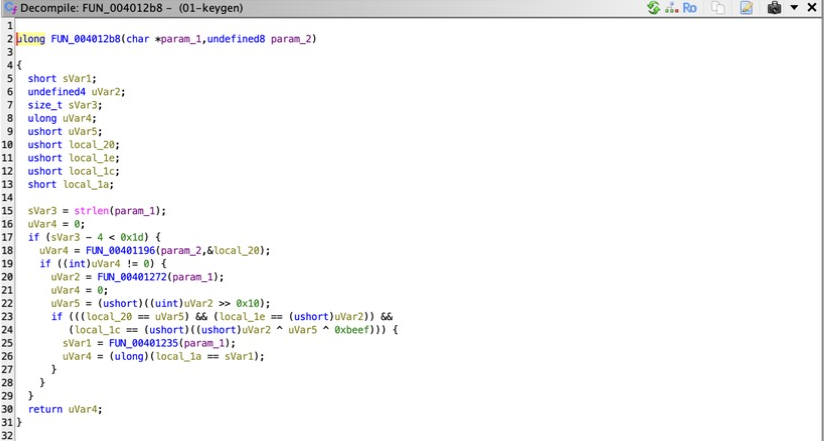
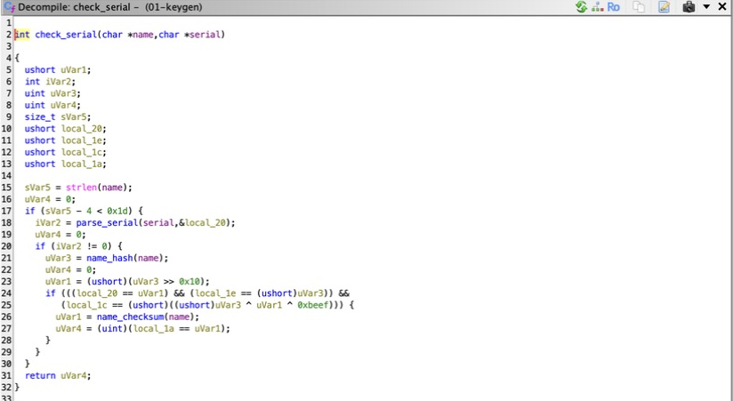

# 01: keygen walkthrough

Binary: `bin/01-keygen` (stripped, non-PIE, base `0x400000`).

## 1. Import and first look

Import the file with default options and accept auto-analysis. Because the
binary is stripped, the Symbol Tree only shows `entry` and `FUN_xxxxxxxx`
names. Run `Triage.java` (or see step 2) to label `main`.

## 2. Find main

Open `entry`. A glibc entry stub loads the address of `main` into `RDI`
and calls `__libc_start_main`:

```
00401xxx  MOV RDI, 0x401335
00401xxx  CALL qword ptr [->__libc_start_main]
```

Double-click `0x401335`, press `F` if no function exists yet, and rename it
to `main` with `L`. `Triage.java` does this automatically.

## 3. Strings and cross-references

Open Window > Defined Strings and filter for `serial`. Two strings stand out:
`Serial accepted. Welcome, licensed user.` and `Invalid serial.`. Select
one and press `Ctrl+Shift+F` (References > Show References to) to jump to
its use in `main`.

In the decompiler, `main` reads as:

```c
if (argc != 3) { usage(); return 2; }
if (FUN_004012b8(argv[1], argv[2]) != 0) { puts("Serial accepted..."); return 0; }
puts("Invalid serial.");
return 1;
```

Rename `FUN_004012b8` to `check_serial`. Retype its parameters to
`char *name, char *serial` with `Ctrl+L` on each one.

## 4. check_serial

The decompiler shows three calls and a series of 16-bit compares against a
local array. Retype the local at `[rsp+0x8]` as `ushort parts[4]` and the
code collapses to:

```c
len = strlen(name);
if (len - 4 > 0x1c) return 0;              /* 4 <= len <= 32 */
if (parse_serial(serial, parts) == 0) return 0;
h = name_hash(name);
if (parts[0] != (ushort)(h >> 16)) return 0;
if (parts[1] != (ushort)h) return 0;
if (parts[2] != ((ushort)h ^ (ushort)(h >> 16) ^ 0xbeef)) return 0;
return parts[3] == name_checksum(name);
```

Note how `-O1` turned the range check into one unsigned compare,
`len - 4 <= 28`. Ghidra shows it as `sVar5 - 4 < 0x1d`.

Before, straight out of auto-analysis:



After renaming the callees and setting the signature:



Rename the three callees as you identify them:

| Address | Name | Purpose |
|---|---|---|
| `0x401196` | `parse_serial` | splits `XXXX-XXXX-XXXX-XXXX` into four 16-bit values, uppercase hex only |
| `0x401272` | `name_hash` | 32-bit hash of the uppercased name |
| `0x401235` | `name_checksum` | weighted byte sum times the name length |

## 5. name_hash

```c
h = 0x1337c0de;
for (p = name; *p != 0; p++) {
  h = (*__ctype_toupper_loc())[*p] ^ h;
  h = (h << 5 | h >> 27) * 0x1000193;
}
return h;
```

`__ctype_toupper_loc` is how glibc implements `toupper`, so the hash is
case-insensitive. Ghidra may show the rotate as `h << 5 | h >> 0x1b`. The
multiplier `0x01000193` is the 32-bit FNV prime, a useful constant to
recognize.

## 6. name_checksum

```c
len = strlen(name);
sum = 0;
for (i = 0; i < len; i++) sum += (uint)name[i] * (i + 1);
return (ushort)(sum * len);
```

This one uses the original case of the name, unlike `name_hash`.

## 7. Keygen

The full algorithm is in [solutions/keygen.py](../solutions/keygen.py):

```
$ python3 solutions/keygen.py Ghidra
E622-4AAD-1260-324C
$ ./bin/01-keygen Ghidra E622-4AAD-1260-324C
Serial accepted. Welcome, licensed user.
```

## 8. Patch it

In `main`, the branch after `check_serial` is:

```
00401352  TEST EAX, EAX
00401354  JNZ  0x0040138f        ; 75 39
```

Right-click the `JNZ`, choose Patch Instruction, and change it to
`JMP 0x0040138f`. The bytes become `eb 39`. Export with File > Export
Program > Original File, then:

```
$ chmod +x 01-keygen.patched
$ ./01-keygen.patched anyone 0000-0000-0000-0000
Serial accepted. Welcome, licensed user.
```
