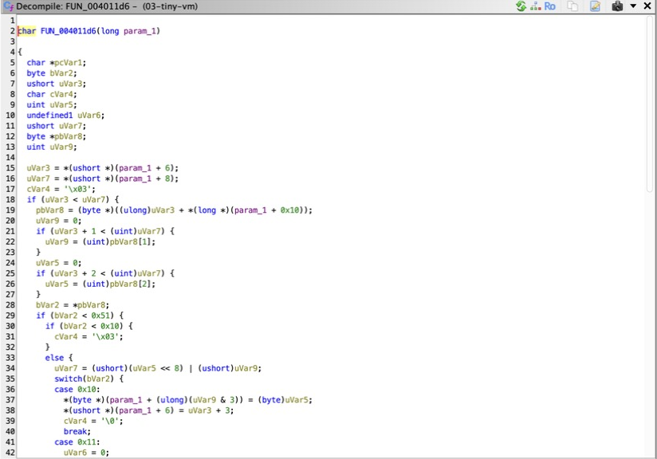
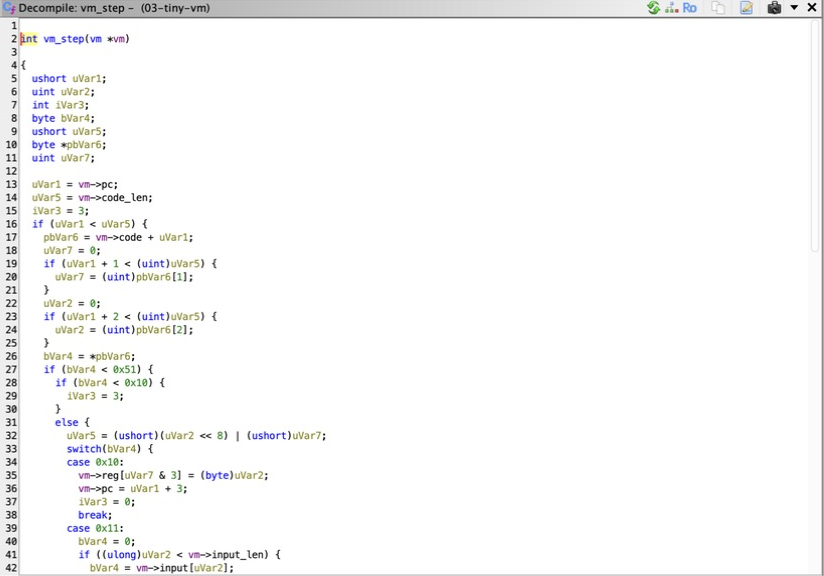
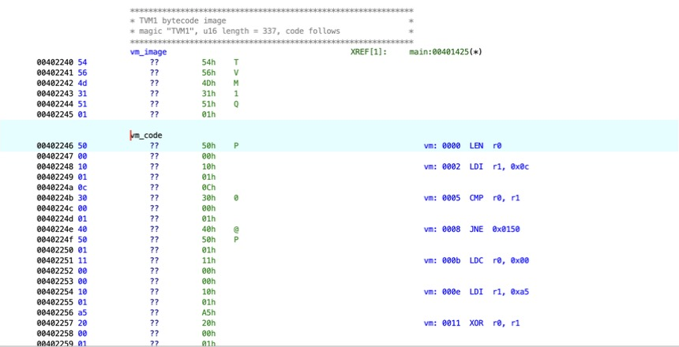

# 03: tiny VM walkthrough

Binary: `bin/03-tiny-vm` (stripped, non-PIE, base `0x400000`).

## 1. Shape of main

Label `main` at `0x40140a`. After cleanup the decompiler shows:

```c
if (argc != 2) { usage(); return 2; }
if (FUN_00401379(local_38, &DAT_00402240, 0x157, argv[1]) == 0) {
  fputs("corrupt VM image\n", stderr); return 3;
}
do {
  state = FUN_004011d6(local_38);
  ...
} while (state == 0 && steps < 10000);
if (state == 1) printf("Correct! Flag: GT{%s}\n", argv[1]);
```

A loader, a step function called in a loop, and a state value where `1`
means accept: this is an interpreter. Rename the callees `vm_load` and
`vm_step`.

## 2. The image format

`vm_load` calls `memcmp(image, "TVM1", 4)`, then reads a little-endian
16-bit length from `image[4..5]` and stores `image + 6` as the code
pointer. At `0x402240` the bytes are:

```
54 56 4d 31  51 01  50 00 10 01 0c 30 ...
"TVM1"       len=0x151  code...
```

## 3. Recover the VM state struct

`vm_load` writes into the stack object passed as its first argument at
fixed offsets, and `vm_step` reads the same offsets:

| Offset | Size | Evidence | Field |
|---|---|---|---|
| `0x00` | 4 x 1 | indexed with `& 3` | `uint8_t reg[4]` |
| `0x04` | 1 | set by compare, read by conditional jump | `uint8_t flag` |
| `0x06` | 2 | compared with code length, advanced by 2 or 3 | `uint16_t pc` |
| `0x08` | 2 | from the image header | `uint16_t code_len` |
| `0x10` | 8 | `image + 6` | `uint8_t *code` |
| `0x18` | 8 | `argv[1]` | `char *input` |
| `0x20` | 8 | `strlen(argv[1])` | `size_t input_len` |

Open the Data Type Manager, create a new structure `vm` of size `0x28`, and
add the fields above. Gaps at `0x05` and `0x0a` are alignment padding. Then
retype `vm_step`'s parameter to `vm *` with `Ctrl+L`. The decompiler output
changes from `*(ushort *)(param_1 + 6)` to `vm->pc`.

A faster route: right-click the parameter in the decompiler and choose
Auto Create Structure, then rename the generated fields.

Before, with raw pointer arithmetic:



After applying `vm *`:



## 4. Recover the instruction set

`vm_step` subtracts `0x10` from the opcode and jumps through a table at
`0x402020`:

```
0040123f  SUB  EDX, 0x10
00401242  CMP  DL, 0x40
00401245  JA   default
0040124e  JMP  qword ptr [RDX*0x8 + 0x402020]
```

Ghidra recovers this as a `switch` with cases for `0x10` through `0x50`,
plus `0xf0` and `0xff` handled before the table. With the struct applied,
each case is a one-liner:

| Opcode | Case body | Mnemonic |
|---|---|---|
| `0x10` | `vm->reg[a & 3] = b; pc += 3` | `LDI r, imm8` |
| `0x11` | `vm->reg[a & 3] = input[b]; pc += 3` | `LDC r, idx` |
| `0x20` | `vm->reg[a & 3] ^= vm->reg[b & 3]` | `XOR r, r` |
| `0x21` | `vm->reg[a & 3] += vm->reg[b & 3]` | `ADD r, r` |
| `0x22` | `vm->reg[a & 3] = rol8(vm->reg[a & 3], b)` | `ROL r, n` |
| `0x30` | `vm->flag = vm->reg[a & 3] == vm->reg[b & 3]` | `CMP r, r` |
| `0x40` | `pc = flag ? pc + 3 : addr16` | `JNE addr` |
| `0x41` | `pc = addr16` | `JMP addr` |
| `0x50` | `vm->reg[a & 3] = input_len; pc += 2` | `LEN r` |
| `0xf0` | return 1 | `OK` |
| `0xff` | return 2 | `FAIL` |

Here `a` and `b` are the two bytes after the opcode and `addr16` is
`a | b << 8`.

## 5. Disassemble the bytecode

Run [ghidra_scripts/VmDisassembler.java](../ghidra_scripts/VmDisassembler.java).
It searches for `TVM1`, skips the copy that is only the `memcmp` literal,
labels `vm_image` and `vm_code`, and puts an EOL comment on each bytecode
instruction so the program reads in the Listing:

```
0000  LEN  r0
0002  LDI  r1, 0x0c
0005  CMP  r0, r1
0008  JNE  0x0150
000b  LDC  r0, 0x00
000e  LDI  r1, 0xa5
0011  XOR  r0, r1
0014  ROL  r0, 0x01
0017  LDI  r2, 0x00
001a  ADD  r0, r2
001d  LDI  r3, 0xeb
0020  CMP  r0, r3
0023  JNE  0x0150
...
014f  OK
0150  FAIL
```

In the Listing, each bytecode instruction carries its decoded form as an
EOL comment:



## 6. Invert the check

The program checks that the input is 12 characters, then repeats one
9-instruction block per character:

```
rol8(input[i] ^ k_i, n_i) + c_i == target_i
```

Each step is invertible, so:

```
input[i] = ror8(target_i - c_i, n_i) ^ k_i
```

[solutions/vm_solve.py](../solutions/vm_solve.py) pattern-matches the
block in the disassembly and solves all twelve characters:

```
$ python3 solutions/vm_solve.py bin/03-tiny-vm
Ph4s3_Sh1ft!
$ ./bin/03-tiny-vm 'Ph4s3_Sh1ft!'
Correct! Flag: GT{Ph4s3_Sh1ft!}
```
